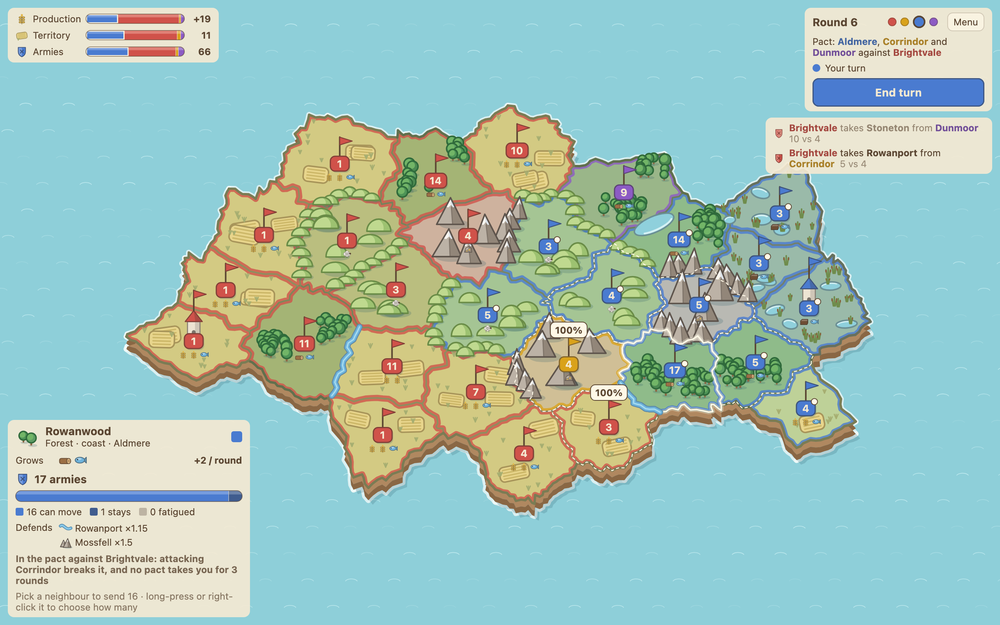
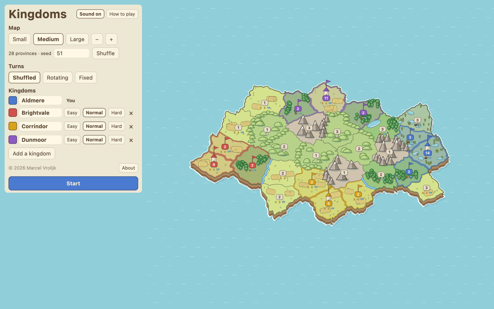
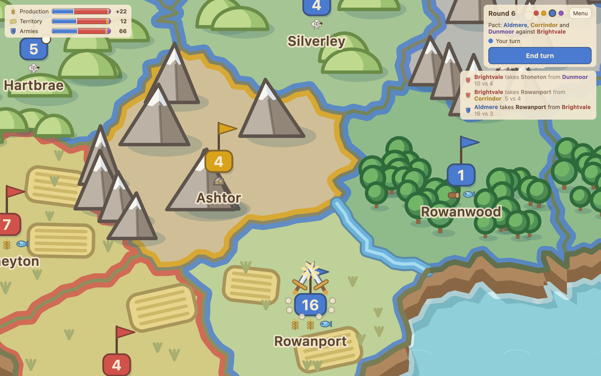

# Kingdoms

[](https://github.com/pmvrolijk/kingdoms/actions/workflows/ci.yml)

A short, cozy, Risk-like strategy game. A small island of provinces and a handful of kingdoms, one of
them yours. Move armies, take provinces, grow armies at home and march them to the front. The last
kingdom standing wins. A game against three AI kingdoms takes 15–30 minutes.

- Generated maps: every seed is a new island, in three sizes.
- One gesture per move: tap a province, then a neighbour. The win chance is shown before you attack.
- Borders behind rivers, ridges, marshes and mountains are easier to defend.
- AI kingdoms with three personalities and three difficulties (Easy, Normal, Hard).
- When one kingdom runs away with the game, the others form a pact against it. That includes you.
- A tabletop look drawn in code, with generated sound effects and a built-in "How to play".



| New game | Up close |
| --- | --- |
|  |  |

## Play

**[Play in your browser](https://pmvrolijk.github.io/kingdoms/)**: the latest release, no install. Needs a browser with
WebAssembly GC (current Chrome, Firefox or Safari); your game is saved in the browser.

Downloads for each version are on the [Releases](../../releases) page:

| Platform | File | Notes |
| --- | --- | --- |
| macOS | `Kingdoms-X.Y.Z.dmg` | Apple silicon. Not notarised: if macOS refuses to open it, choose Open Anyway under System Settings → Privacy & Security. |
| Linux | `kingdoms_….deb` | Debian, Ubuntu and relatives: `sudo apt install ./kingdoms_*.deb` |
| Android | `Kingdoms-X.Y.Z.apk` | Android 8.0 or later. Allow installing from your browser or file manager. |
| Web | `Kingdoms-X.Y.Z-web.zip` | A static site. Serve it over HTTP, e.g. `python3 -m http.server` in the unzipped folder, then open http://localhost:8000. Opening `index.html` as a file does not work. Needs a browser with WebAssembly GC (current Chrome, Firefox or Safari). |

iOS builds from source with Xcode; there is no download yet.

## Build from source

Needs JDK 21. The Android SDK is needed for the Android app, and Xcode for iOS.

```sh
./gradlew :composeApp:run                           # desktop app
./gradlew :composeApp:wasmJsBrowserDevelopmentRun   # web app on http://localhost:8080
./gradlew :androidApp:assembleDebug                 # APK in androidApp/build/outputs/apk/debug/
open iosApp/iosApp.xcodeproj                        # iOS app; the build calls Gradle
./gradlew :core:allTests :composeApp:jvmTest        # tests
```

## Project

| | |
| --- | --- |
| `core` | The game: map generator, rules, AI, simulation. Pure common Kotlin, no UI. |
| `composeApp` | The Compose Multiplatform app for desktop, Android, iOS and web. |
| `androidApp`, `iosApp` | Thin platform shells around `composeApp`. |
| [`docs/Design.md`](docs/Design.md) | What the game does, and why: the one design document. |
| [`docs/Status.md`](docs/Status.md) | Where development stands and what is next. |

Written in Kotlin Multiplatform with Compose Multiplatform. The tests run on every push, and a
`v*` tag builds the release files ([`.github/workflows`](.github/workflows)).

## Licence

Copyright © 2026 Marcel Vrolijk.

Kingdoms is free software: you can redistribute it and/or modify it under the terms of the GNU
Affero General Public License as published by the Free Software Foundation, either version 3 of
the License, or (at your option) any later version. It is distributed in the hope that it will be
useful, but WITHOUT ANY WARRANTY; without even the implied warranty of MERCHANTABILITY or FITNESS
FOR A PARTICULAR PURPOSE. See [`LICENSE`](LICENSE) for the full text.

If you run a modified version for others over a network, such as a hosted copy of the web
version, the licence asks you to offer them its source code.
